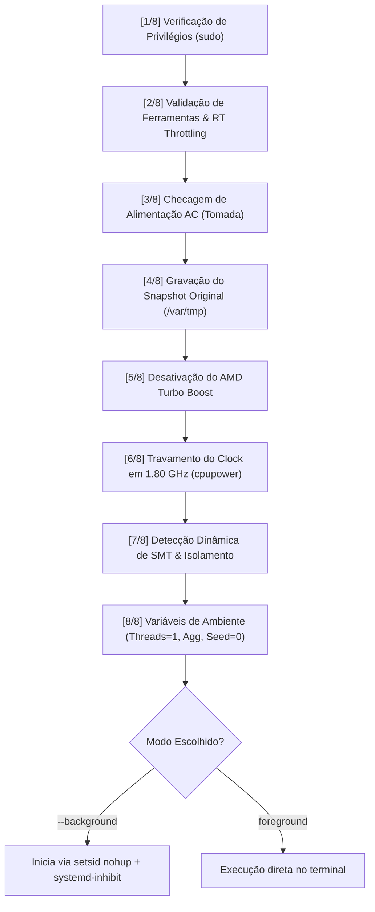

# Bancada de Benchmarking de Alta Estabilidade (Metodologia F.O.C.A.)

Este diretório contém os scripts de automação, isolamento de hardware e execução empírica desenvolvidos para atender ao rigor metodológico da disciplina de **Engenharia de Programas** (UNEB).

O objetivo central desta infraestrutura é garantir que as medições de tempo do algoritmo **Fuzzy C-Means / K-Means** operem sob condições laboratoriais estritas, eliminando fontes de ruído computacional para sustentar um **Coeficiente de Variação estável ($CV < 0.15$)**.

---

## 📋 Sumário
1. [Visão Geral e Desafios de Hardware](#-visão-geral-e-desafios-de-hardware)
2. [Estrutura dos Arquivos](#-estrutura-dos-arquivos)
3. [Arquitetura do `executar_benchmark_otimizado.sh`](#-arquitetura-do-executar_benchmark_otimizadosh)
   - [As 8 Etapas de Preparação da Máquina](#as-8-etapas-de-preparação-da-máquina)
   - [Mecanismos de Segurança e Redução de Riscos](#mecanismos-de-segurança-e-redução-de-riscos)
4. [Guia de Utilização](#-guia-de-utilização)
   - [Simulação Segura (`--dry-run`)](#1-simulação-segura---dry-run)
   - [Execução em Segundo Plano (`--background`)](#2-execução-em-segundo-plano---background)
   - [Acompanhamento de Logs ao Vivo (`logs`)](#3-acompanhamento-de-logs-ao-vivo-logs)
   - [Verificação de Status do Hardware e Processo (`status`)](#4-verificação-de-status-do-hardware-e-processo-status)
   - [Interrupção Controlada (`stop`)](#5-interrupção-controlada-stop)
   - [Restauração Manual do Sistema (`restore`)](#6-restauração-manual-do-sistema-restore)
5. [Caderno de Visualização (`visualizar_benchmark.ipynb`)](#-caderno-de-visualização-visualizar_benchmarkipynb)
6. [Métricas de Calibração Geradas](#-métricas-de-calibração-geradas)

---

## 🔬 Visão Geral e Desafios de Hardware

Executar testes empíricos de algoritmos com rigor científico em notebooks portáteis apresenta desafios severos de microarquitetura e gestão de energia:

- **Thermal Throttling & STAPM:** O processador **AMD Ryzen™ 7 5700U** possui TDP móvel restrito (15W–25W). Laços pesados sustentados aumentam a temperatura do encapsulamento, forçando o corte abrupto do clock dinâmico e provocando alta dispersão amostral ($CV \ge 0.15$).
- **Precision Boost Oscilante:** A variação contínua entre 400 MHz e 4.37 GHz faz com que repetições idênticas executem sob velocidades de clock arbitrárias.
- **Contenção de SMT (Simultaneous Multithreading):** Dois threads lógicos dividem os mesmos caches **L1d (32 KiB)** e **L2 (512 KiB)**. Se um processo do SO executar na thread irmã, causa expulsão de dados (*cache thrashing*).

Para mitigar esses problemas, a suíte de scripts implementa controle cirúrgico sobre o kernel Linux e os subsistemas de hardware.

---

## 📂 Estrutura dos Arquivos

```
docs/samuca_files/scripts/
├── executar_benchmark_otimizado.sh # Orquestrador principal com isolamento e modo background
├── experimentador_EP_2026.2.py     # Script de bancada com medições em time.perf_counter()
├── restaurar_sistema.sh            # Script de restauração manual das configurações de fábrica
├── visualizar_benchmark.ipynb      # Notebook Jupyter leve para monitoramento sem concorrência
├── benchmark.pid                   # Arquivo com o PID do processo atualmente em execução
├── logs/                           # Diretório com os registros timestamped do benchmark
│   └── benchmark_YYYYMMDD_HHMMSS.log
└── resultados_foca_aluno.csv       # Tabela exportada com médias, desvios e validação de CV
```

---

## ⚙️ Arquitetura do `executar_benchmark_otimizado.sh`

### As 8 Etapas de Preparação da Máquina

Ao disparar o script, ele percorre uma sequência padronizada de verificações e modificações:



1. **Verificação de Privilégios:** Confirma execução com `EUID == 0` ou eleva automaticamente via `sudo --preserve-env`. Subcomandos de leitura (`--dry-run`, `status`, `logs`) operam sem exigir root.
2. **Validação de Ferramentas e Segurança:** Valida a presença de `cpupower`, `chrt`, `setarch`, `taskset` e do interpretador virtual `.venv`. Verifica se `/proc/sys/kernel/sched_rt_runtime_us` não é `-1` para assegurar que a proteção contra *lockup* em tempo real está ativa no kernel.
3. **Verificação de Alimentação AC:** Lê `/sys/class/power_supply/` e emite alerta visual imediato caso o notebook esteja na bateria, prevenindo degradação por economia de energia.
4. **Snapshot do Estado Original:** Salva o estado pré-existente do hardware em `/var/tmp/foca_estado_original.env` (governor, frequências mín/máx, boost e estado online do irmão SMT).
5. **Desativação do Precision Boost:** Grava `0` em `/sys/devices/system/cpu/cpufreq/boost` com validação de escrita.
6. **Clock Travado no Valor Nominal:** Define o governor para `performance` e fixa o clock mínimo e máximo em **1.80 GHz** via `cpupower frequency-set -u 1800000 -d 1800000`.
7. **Isolamento de Núcleo e Desativação Dinâmica de SMT:** Lê `/sys/devices/system/cpu/cpu13/topology/thread_siblings_list` e descobre o irmão SMT (CPU 12). Coloca a CPU 12 *offline* (`/sys/devices/system/cpu/cpu12/online = 0`), garantindo que a CPU 13 tenha 100% da largura de banda dos caches L1 e L2 e pipeline exclusivos. Nunca desativa a CPU 0 nem a CPU alvo.
8. **Controle de Threads e Interpretador:**
   - `OMP_NUM_THREADS=1`, `OPENBLAS_NUM_THREADS=1`, `MKL_NUM_THREADS=1`: Impede paralelismo silencioso em operações matriciais pequenas.
   - `PYTHONHASHSEED=0`: Força determinismo em coleções de dados do Python.
   - `MPLBACKEND=Agg`: Permite que `plt.show()` não bloqueie sem interface gráfica e que `plt.savefig()` salve as figuras perfeitamente.

### Mecanismos de Segurança e Redução de Riscos

| Risco Identificado | Comportamento Anterior | Mitigação Implementada |
| :--- | :--- | :--- |
| **Starvation do Kernel** | `chrt -f 99` (prioridade máxima absoluta) | Reduzido para `chrt -f 10` e checagem de `sched_rt_runtime_us`. Permite que threads do kernel (`ksoftirqd`, `rcu`) operem sem risco de travamento do sistema. |
| **Irmão SMT Hardcoded** | CPU 12 fixa no código | Detecção dinâmica via `thread_siblings_list`, com proteção para nunca desativar CPU 0 nem a CPU 13. |
| **Valores Hardcoded de Restauração** | Frequências padrão fixas (411000 / 4373000) | Snapshot dinâmico salvo em `/var/tmp/foca_estado_original.env` antes da alteração. |
| **Suspensão Acidental** | Notebook entra em suspensão ao fechar tampa ou inatividade | Injeção de `systemd-inhibit --what=sleep:idle:handle-lid-switch --mode=block`. |
| **Fechamento do Terminal / SSH** | Interrupção do benchmark pelo sinal `SIGHUP` | Execução desacoplada via `setsid nohup` redirecionando para arquivo de log dedicado. |
| **Restauração Precoce** | `trap` automático desfazia configurações antes da validação | Remoção de traps automáticos no modo background. O sistema avisa que continua travado até restauração manual explícita. |

---

## 🚀 Guia de Utilização

### 1. Simulação Segura (`--dry-run`)
Permite inspecionar todos os comandos, checagens de kernel e parâmetros de hardware sem aplicar qualquer modificação e sem exigir senha de administrador:
```bash
./executar_benchmark_otimizado.sh --dry-run
```

### 2. Execução em Segundo Plano (`--background`)
Inicia o isolamento de hardware e dispara o experimentador desacoplado da sessão atual do terminal:
```bash
sudo ./executar_benchmark_otimizado.sh --background
```

### 3. Acompanhamento de Logs ao Vivo (`logs`)
Acompanha o tail do arquivo de log mais recente gerado dentro de `logs/`:
```bash
./executar_benchmark_otimizado.sh logs
```
*(Para sair da exibição contínua do log, pressione `Ctrl+C`).*

### 4. Verificação de Status do Hardware e Processo (`status`)
Exibe o PID em execução, afinidade real via `taskset`, política de escalonamento via `chrt`, frequência real da CPU 13 e estado da CPU irmã:
```bash
./executar_benchmark_otimizado.sh status
```

### 5. Interrupção Controlada (`stop`)
Envia `SIGTERM` para o PID do benchmark, aguarda a finalização graciosa e limpa o arquivo de lock:
```bash
./executar_benchmark_otimizado.sh stop
```

### 6. Restauração Manual do Sistema (`restore`)
Reverte o notebook para o modo original de economia de energia, reativa o Turbo Boost e coloca o irmão SMT novamente online:
```bash
sudo ./restaurar_sistema.sh
# ou alternativamente:
sudo ./executar_benchmark_otimizado.sh restore
```

---

## 📓 Caderno de Visualização (`visualizar_benchmark.ipynb`)

Para não comprometer o experimento em andamento, o caderno [`visualizar_benchmark.ipynb`](file:///home/s-cesar/codes/softwareEngineerDocs/docs/samuca_files/scripts/visualizar_benchmark.ipynb) foi desenvolvido para ser executado sem gerar carga computacional:
- **Painel de Hardware:** Checa o status do processo e se o clock continua fixado em 1.80 GHz.
- **Leitor de Iterações:** Lê as últimas linhas do arquivo `logs/benchmark_*.log` e exibe em quais imagens e repetições o algoritmo se encontra.
- **Tabela de Estabilidade:** Carrega e formata o `resultados_foca_aluno.csv`.
- **Renderização Gráfica:** Exibe os gráficos `relatorio_complexidade2.png` e `superficie_3d_foca.png` assim que salvos pelo experimentador.

---

## 📊 Métricas de Calibração Geradas

Após o processamento de todas as imagens ($n$) e clusters ($K \in \{2, 3, 4\}$) com $R = 30$ repetições, o pipeline produz:

1. **Tabela de Estabilidade (`resultados_foca_aluno.csv`):**
   - Média de tempo por par $(n, K)$
   - Desvio padrão ($\sigma$)
   - Coeficiente de Variação ($CV = \sigma / \mu < 0.15$)
2. **Modelo Polinomial Empírico:**
   $$T(n, K) = \alpha \cdot (n \cdot K) + \beta \cdot n + \gamma \cdot K + \delta$$
3. **Imagens de Saída:**
   - `../outputs/relatorio_complexidade2.png` (Curvas 2D: $T \times n$ e $T \times K$)
   - `superficie_3d_foca.png` (Superfície teórica 3D sobreposta aos pontos reais medidos)
